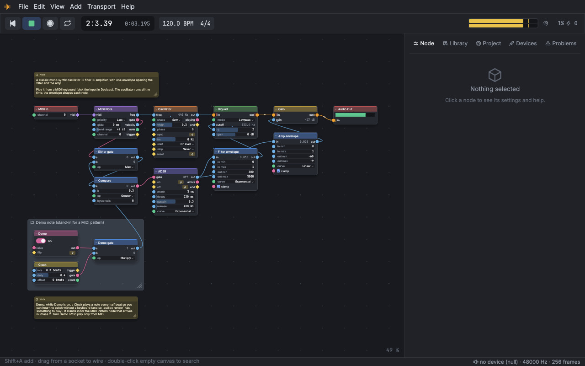

# Audio Constructor

**A node-based audio construction suite.** Build instruments, effects, recorders,
sequencers, and things that don't have names yet, by wiring together small,
composable nodes, the way Blender's geometry nodes let you build visuals.

> Status: Phase 1 (foundation) is built: the engine, 32 nodes, the command
> line, and the desktop editor. See [docs/ROADMAP.md](docs/ROADMAP.md) for
> where things stand and what still needs a human with audio hardware.


## The idea

Most audio software hands you finished tools: a multitrack recorder, a
compressor, a synth with a fixed signal path. Audio Constructor hands you the
parts those tools are made of and lets you wire them up however you like.

- **Everything is a node or a wire.** Tracks, mixers, synths, effect chains,
  and even the virtual keyboard you play them with are all built from nodes.
  Anything that looks like a "view" is just a view onto nodes and wires.
- **Every parameter is a socket.** An oscillator can drive a speaker, or it can
  drive the volume knob of another node, or the cutoff of a filter, or the
  tempo of a sequencer. If a value can be set, it can be wired.
- **Small tools that compose.** In the Unix spirit, nodes do one thing. A
  compressor isn't a node; an envelope follower, a gain computer, and a
  multiplier are nodes, and a compressor is a group of them you can open up,
  modify, and share. Sidechaining falls out for free because the detector
  input is just another socket.
- **Groups are reusable blocks.** Package any subgraph into a block with its
  own sockets, reuse it across projects, share it with others, and import
  blocks others have made.
- **Real time when it can be, offline when it must be.** Plug a guitar in and
  play through your patch live. Nodes that need to see the future (reverse,
  time-stretch) switch themselves off in live mode when their input is a live
  source, and bake themselves in the background when it isn't.
- **Serious and fun.** Sample-accurate timing, deterministic rendering, and a
  real-time engine built for professional work, wrapped in a UI that makes
  experimenting feel like play.

## Platforms and hardware

- Native on macOS, Windows, and Linux, with a web (WebAssembly) build planned.
- Audio in/out through CoreAudio, WASAPI, ASIO, ALSA, JACK/PipeWire, and
  Web Audio.
- MIDI in/out, game controllers, the computer keyboard, and OSC as control
  sources. Press the A button to start recording; sweep a filter with a
  thumbstick.
- Runs modest projects on modest machines and scales across cores for big ones.

## Three ways to use it

1. **The app**: a node editor with live meters, inline controls, and a
   transport.
2. **The command line**: `audioc render` turns a project into a WAV file for
   batch jobs and automation; `audioc run` runs a project headless on a box
   with no screen.
3. **A plugin** (planned): the engine packaged as a CLAP/VST3 effect and
   instrument so patches run inside any host. Hosting third-party plugins as
   nodes is also planned.

## Getting started

### Build

You need a Rust toolchain from [rustup](https://rustup.rs); the repository
pins the exact version in `rust-toolchain.toml`, and rustup installs it on
first build.

- **Linux:** `pkg-config` and the ALSA development headers, e.g.
  `sudo apt install pkg-config libasound2-dev` (Debian/Ubuntu) or
  `sudo dnf install pkgconf alsa-lib-devel` (Fedora). The editor needs a
  desktop session (X11 or Wayland) and a GPU driver with Vulkan or OpenGL.
  For JACK, build with `--features jack` (needs the JACK development
  files); PipeWire works through its ALSA and JACK shims.
- **Windows ASIO** (optional): build with `--features asio` and the
  Steinberg ASIO SDK (`CPAL_ASIO_DIR`); WASAPI works without it.
- **macOS and Windows:** nothing extra.

```
cargo build --release
```

This builds two programs into `target/release/`: `audio-constructor` (the
editor) and `audioc` (the command line).

### Run the editor

```
cargo run --release -p ac-app                                  # opens the Start example
cargo run --release -p ac-app -- examples/guitar-pedalboard.acproj
```

Press `Space` to play, `Shift+A` to add a node, drag between sockets to
wire, `Ctrl+Z` to undo. Pick your audio interface and MIDI keyboard in the
side panel's **Devices** tab (`N` toggles the panel). The examples in
`examples/` are good places to start: **Start**, **Guitar Pedalboard**,
**Subtractive Synth**, **Four Tracks**, and **Reverse Delay** (a Phase 2
preview).



### Use the command line

```
audioc render examples/subtractive-synth.acproj -o synth.wav   # offline render (16/24/32f WAV)
audioc run examples/guitar-pedalboard.acproj                    # live, headless; Ctrl+C stops
audioc run examples/start.acproj --null --duration 5            # same, without audio hardware
audioc devices                                                  # audio and MIDI devices
audioc latency                                                  # round trip via a loopback cable
audioc validate my.acproj                                       # compile report
audioc inspect my.acproj                                        # nodes, wires, groups
audioc nodes                                                    # every node (also --json, --docs DIR)
audioc bench                                                    # real-time ratio on stress projects
```

(`cargo run --release -p ac-cli -- <args>` runs `audioc` without
installing it; `cargo install --path crates/ac-cli` installs it.)

### Develop

```
cargo fmt --all
cargo clippy --workspace --all-targets -- -D warnings
cargo test --workspace
cargo check -p ac-core -p ac-dsp -p ac-nodes -p ac-engine --target wasm32-unknown-unknown
cargo deny check
```

The node reference in [docs/reference](docs/reference/README.md) is generated
from the nodes' doc comments with `audioc nodes --docs docs/reference`.

## Documentation

| Document | What it covers |
| --- | --- |
| [docs/ROADMAP.md](docs/ROADMAP.md) | Phases, milestones, and acceptance criteria |
| [docs/ARCHITECTURE.md](docs/ARCHITECTURE.md) | Engine, signal model, scheduling, real-time rules, persistence |
| [docs/NODES.md](docs/NODES.md) | The node catalog and node design conventions |
| [docs/UX.md](docs/UX.md) | Look and feel, editor behaviors, conveniences |
| [docs/DECISIONS.md](docs/DECISIONS.md) | Decision log with alternatives considered |
| [docs/reference](docs/reference/README.md) | Generated reference for every node |
| [CLAUDE.md](CLAUDE.md) | Working agreements for AI agents contributing to the repo |

## License

MIT. See [LICENSE](LICENSE).
