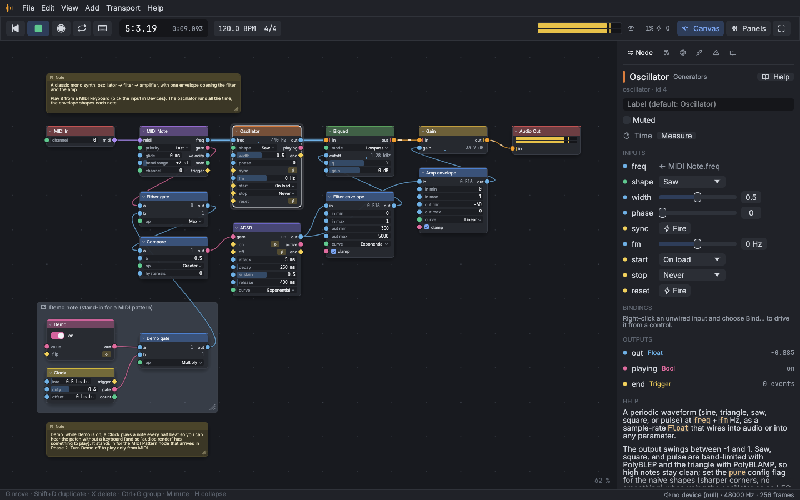

# Building sounds

This chapter builds a synthesizer from scratch, then makes it playable
from MIDI, polyphonic, and moving, and ends with effects and spectral
tools. Each section names the nodes it uses; the
[node reference](../reference/README.md) (or `F1` on a node) has every
socket and setting.

## How a patch works

Sound flows along wires from left to right: from sources (an oscillator,
an audio file, your microphone), through processors (filters, delays,
gains), into an **Audio Out** node, which is your speakers or headphones.
A patch can have several Audio Out nodes; what they play adds up.

Every value you can set is also a socket. A filter's cutoff, a delay's
time, or a gain's level can be set by hand with the control on the node,
or wired from another node so it moves by itself. That is how envelopes,
LFOs, and sequencers work: they're ordinary nodes whose outputs are wired
into other nodes' inputs.

## A first synth

You'll build oscillator → filter → amplifier, with an envelope shaping
each note, played from an on-screen keyboard. The **Subtractive Synth**
example is the finished version of this patch.

### 1. A tone

1. **File ▸ New** (`Ctrl+N`). The new project has an Oscillator wired into
   an Audio Out.
2. On the Oscillator, set `shape` to **saw**, a bright tone with plenty
   for a filter to work on.
3. Set its `start` to **On load** and `stop` to **Never**. The oscillator
   now runs all the time, whether or not the transport plays; the
   envelope you'll add decides when you hear it.

The sound is loud at this point. Turn your speakers down until step 2.

### 2. A filter and an amplifier

1. Press `Shift+A`, type `lpf`, and press `Enter` to add a **Biquad**.
   Drag it onto the wire between the Oscillator and Audio Out: it splices
   in. Its `mode` is already **lowpass**.
2. Do the same with a **Gain** (type `gain` or `volume`), dropped onto the
   wire after the Biquad.
3. Set the Gain's `gain` to −60 dB: silence, until the envelope opens it.

### 3. A keyboard

1. Add a **Keyboard** (type `keyboard` or `piano`). It is a piano you play
   by clicking, and it sends MIDI.
2. Add a **MIDI Note** and wire the Keyboard's `midi` into its `midi`.
   MIDI Note turns notes into signals: `freq` (the pitch in Hz), `gate`
   (on while a key is held), and `velocity`.
3. Wire MIDI Note's `freq` into the Oscillator's `freq`.

### 4. An envelope

1. Add an **ADSR** and wire MIDI Note's `gate` into its `gate`. While the
   gate is on, the ADSR's `out` rises from 0 to 1 (`attack`), falls to
   `sustain` (`decay`), and holds; when the key is let go it falls back to
   0 (`release`).
2. The Gain wants decibels, and the envelope goes from 0 to 1, so add a
   **Map** between them: wire the ADSR's `out` into the Map's `in`, set
   `out_min` to −60 and `out_max` to −6, and wire the Map's `out` into the
   Gain's `gain`.
3. Click the keys of the Keyboard. Each note now swells in and fades out.

### 5. A filter envelope

1. Select the Map and press `Shift+D` to copy it. Wire the ADSR's `out`
   into the copy's `in` too.
2. Set the copy's `out_min` to 300, `out_max` to 5000, and `curve` to
   **exponential** (pitch and cutoff sound even on an exponential scale).
3. Wire its `out` into the Biquad's `cutoff`, and raise the Biquad's `q`
   to about 2 for a little resonance.

Each note now starts bright and darkens as it decays: the classic
subtractive synth sound.

> **Try this:** set the ADSR's `attack` to 0.5 s and `release` to 2 s for
> a pad, or `decay` to 0.1 s and `sustain` to 0 for a pluck.

### 6. Play it from a MIDI keyboard

Replace the Keyboard with a **MIDI In** node (delete the Keyboard, add
MIDI In, and wire its `midi` into MIDI Note's `midi`). MIDI In hears every
connected MIDI input; see [Sound devices](getting-started.md#midi). Set
its `channel` to listen to one MIDI channel only (0 hears them all).

To play the computer keyboard like a piano instead, use a **Keyboard In**
node; see [Performing](performing.md#the-computer-keyboard).

> **Try this:** set MIDI Note's `glide` to 0.1 s for a sliding, portamento
> lead.

## Polyphony with Voices

The synth above plays one note at a time: MIDI Note follows the last key
held. To play chords, the voice has to exist once per note. A **Voices**
node does that: it holds a group (its *body*) and runs one copy of it for
each note, then adds the copies' outputs together.

### The quick way: a block

1. Press `Shift+A` and type `subtractive synth voice`. The **Subtractive
   Synth Voice** block (two detuned saws, a ladder filter, and an
   envelope) comes in as a Voices node.
2. Wire a MIDI source into its `midi` input and its `out` into Audio Out.
3. Play chords. Its other inputs (`cutoff`, `resonance`, `attack`, …) reach
   every voice at once.

The **Karplus-Strong String** (a plucked string) and **FM Operator Pair**
(bells, electric pianos, brass) blocks work the same way.

A mouse can only hold one key at a time, so for chords play a MIDI
keyboard, or the computer keyboard through a Keyboard In node, or let a
**MIDI Pattern** play them (the **Sidechain Pump** example does).

### Your own voice

1. Add a **Voices** node from the palette. It comes with a starter body:
   a saw Oscillator and an ADSR multiplied together.
2. Double-click it (or press `Ctrl+Enter`) to go inside. The **Voice** node there
   is the note this copy plays: `freq`, `gate`, `velocity`, `note`, a
   `trigger` on each new note, and `index`, which copy this is (0, 1, 2,
   …).
3. Change the voice like any patch: add a filter, a second oscillator, a
   filter envelope. Every copy follows. Press `Ctrl+Enter` to come back out.
4. In the Node tab, **Settings** sets how many **Voices** there are (1 to
   64, default 8) and, under **When all are busy**, which note gives way
   when you play more notes than that: the oldest by default, or the
   newest, the lowest, the highest, or none (the new note is ignored).

Any group can become polyphonic: select it and tick **Polyphonic (one
copy per voice)** in the Node tab. Inside, use a Voice node instead of
MIDI Note to read each copy's note. Inputs of the group show on the
Voices node and reach every voice; Audio and Float outputs are added up
over the voices. The sustain pedal holds released notes, and pitch bend
reaches every voice.

> **Try this:** inside a Voices body, multiply the Voice's `index` by 0.3
> and wire it into a **Pan**'s `pan`, so each new voice sits further to the
> right.

More voices cost more processor time. The Voices node's badge shows its
voice count, and [node timing](editor.md#node-timing) shows the total for
all voices.

## Modulation

Modulation is wiring a moving signal into a parameter. Some sources:

| Node | Moves | Good for |
| --- | --- | --- |
| **LFO** | A slow repeating wave: sine, triangle, saw, ramp down, square, random, smooth random | Vibrato, tremolo, filter sweeps. Light enough to use by the hundred |
| **Oscillator** | The same at audio rate (tick **Pure** in its Settings for sharp corners) | FM, fast wobbles, ring modulation (multiply two with **Math**) |
| **ADSR**, **Envelope** | A shape each time a gate opens; Envelope is drawn as breakpoints, with sustain and loop points | Notes, swells, filter envelopes |
| **Graph** | A drawn curve played over a time you set | Automation lanes, one-off sweeps, custom LFO shapes when looped |
| **Step Sequencer** | A row of values, one step per `clock` trigger | Arpeggiated filters, rhythmic gates, melodies |
| **Random Walk** | A smooth wander around a center | Slow drift, "analog" instability |
| **Random**, **Sample & Hold** | A new value on each trigger | Random notes, stepped noise |
| **Envelope Follower** | The level of a sound | Making one sound control another (auto-wah, ducking) |

Most modulators put out a value in a fixed range (an LFO from −1 to 1,
an ADSR from 0 to 1), and the input you're driving wants its own units:
hertz, decibels, seconds. A **Map** in between converts one range into
the other. **Math** adds, multiplies, and so on, so you can add an LFO to
a base value; **Smooth** takes the edges off a stepped signal; **Convert**
turns decibels into gain, notes into hertz, beats into seconds.

> **Try this:** wire an LFO (`rate` 0.2 Hz) through a Map (`in_min` −1,
> `in_max` 1, `out_min` 400, `out_max` 4000, `curve` exponential) into a
> Biquad's `cutoff` for a slow sweep.

Things in time with the music take beats: a **Clock** ticks every
`interval` beats, LFOs and Delays have beat modes, and the
[Transport](../reference/generators.md#transport) node gives the song
position as signals. Set the tempo by clicking the tempo in the transport
bar, or in the Project tab's tempo map, which can change tempo during the
song.

## Effects

Effects come two ways: as nodes, which do one job, and as **blocks**, which
are groups of nodes saved for reuse. Blocks are in the palette and the
Library tab like nodes. Double-click one to see how it's built and
change it (see [Blocks and sharing](blocks.md)).

### Delay and space

- **Delay**: echoes. `time` in seconds, or in beats when its **Time in**
  setting is beats; `feedback` for more repeats; `mix` from dry to all
  echoes. Changing `time` while it plays bends the pitch like tape.
- **Plate Reverb** and **Hall Reverb** (blocks): `predelay`, `decay`,
  `damping` (how quickly the highs fade), and `mix`.
- **Diffuser**: smears a sound into a dense wash, the core of a reverb.
- **Comb** and **Allpass**: the filters reverbs and resonators are built
  from.
- **Chorus**, **Flanger**, **Phaser**, **Vibrato**, **Tremolo**,
  **Auto-Wah** (blocks): the classic modulation effects.
- **Freeze** holds a short loop of the input while `hold` is on;
  **Pitch Shift** moves pitch without changing speed; **Reverse** plays
  its input backwards (see [Live and baked](live-and-baked.md)).
- **Stutter** and **Tape Stop** (blocks): performance effects.

### Dynamics

Dynamics in Audio Constructor are built from three nodes you can rewire:
an **Envelope Follower** measures the level, a **Gain Computer** decides
how much to turn down, and a **Gain** does it. The blocks package the
usual arrangements:

- **Compressor**: `threshold`, `ratio`, `attack`, `release`, `knee`, and
  `makeup`; its `gain_reduction` output shows how hard it's working.
- **Limiter**: keeps peaks under `ceiling`. A good last step before an
  output or a render.
- **Noise Gate**: silences the signal between notes.
- **Sidechain Ducker**: turns `in` down while the `sidechain` input is
  loud, for a pad that pumps with a kick drum or music that dips under a
  voice.
- **Multiband Compressor**: compresses lows, mids, and highs separately.

> **Try this:** open the **Sidechain Pump** example and wire the hats into
> the ducker's `sidechain` instead of the kick.

### Level and mixing

**Gain** sets level in decibels (−60 dB and below is silent), **Pan**
places a signal left to right, **Mix** adds several signals with a gain
each (set the number of inputs in its Settings), and **Crossfade** blends
two. The **Track** block is a mixer channel with volume, pan, mute, and
solo. **Meter** and **Scope** show a signal and pass it through, so put
them anywhere in a chain; **Analyzer** shows its spectrum.

## Spectral tools

Spectral nodes work on a sound's frequencies instead of its samples.

- **FFT** turns audio into a stream of spectra (Spectrum wires, cyan
  squares) and **IFFT** turns them back. Between the two, process the
  spectrum: **Spectral Gate** silences quiet frequencies (a noise
  reduction per frequency), and **Spectral Shift** moves every partial up
  or down for metallic and shimmering sounds. Give the IFFT the same
  **Window** setting as the FFT.
- **Band Split** splits a sound into frequency bands that add back up to
  the original, one output per band, for multiband processing. Drag,
  split, and merge the bands in its band editor in the Node tab.
- **Pitch Detect** follows the pitch of a single note (a voice, a guitar)
  and puts it out as a frequency, a note number, how confident it is, and
  a trigger on each new note. The **Guitar-to-Synth** example uses it.

An FFT delays the sound by its frame size (2048 samples by default, about
43 ms at 48 kHz). The engine delays the other paths to match where they
meet, so a dry signal mixed back in stays lined up; see
[Latency](live-and-baked.md#latency).

> **Try this:** wire a Clip through FFT → Spectral Shift (`scale` 2) →
> IFFT, and mix it quietly under the dry Clip for an octave shimmer.

## Drums and samples

- **Clip** plays an audio file: choose it in the Node tab, then loop it,
  reverse it, or change its `rate`.
- **Sampler** plays a sound at any pitch (`note` against its **Root note**
  setting) with start, end, and loop points. It plays a file, or a
  `buffer` straight from a Record node or a **Sample** node. The Node tab
  draws the sound: drag the white handles to set where it starts and
  ends, and watch the playhead. `velocity` (0 to 1) makes each note as
  loud as it was played.
- **Sample** is a file as a sound to wire, so one file can feed several
  Samplers or a block.
- **Slicer** cuts a sound into slices, equally, at its hits, or where you
  click in its waveform, and plays them one at a time, by number or from
  MIDI notes: a drum loop becomes a kit on a pad grid.
- **Note Split** turns MIDI into a trigger, a gate, and a velocity for
  each note of a list, so a drum pad's notes reach their sounds in one
  node; give notes a choke group and the closed hat cuts the open one.
  **Velocity** reshapes how hard notes play.
- **Zones** looks a note up in a map of key and velocity zones you draw in
  the Node tab, for keymapped instruments and soft and hard layers;
  **Route** sends a trigger (or MIDI, audio, a sound) to one of several
  outputs, for round robin.
- Drop a WAV file on the canvas for a Clip (hold `Shift` for a Sampler),
  on a Clip or Sampler to give it that sound, or on a panel for a pad that
  plays it.
- **Pattern** is a grid of step buttons: one step per `clock` trigger, a
  `trigger` and `gate` output per row. The **Drum Machine** block wraps a
  Pattern and four synthesized drums; **Euclidean Drummer** spreads hits
  evenly over cycles of different lengths.
- **Clock**, **Clock Divide**, **Euclidean**, **Probability**, and
  **Burst** make and shape rhythms.

## Loops in a patch

A wire path that leads back to where it started (a delay feeding itself,
for instance) is refused unless it goes through a **Feedback** node, and
the Problems tab says which nodes form the loop. Feedback delays the
signal by one buffer, which makes the loop possible. The **Tape Loop**
example is built around one.

For loops whose timing matters to the sound (a plucked string whose pitch
is the loop's length, a filter with its output fed back into its input),
set the Feedback node's **Delay round the loop** to **sample** in the
Node tab. The nodes on that loop then run one sample at a time while the
rest of the patch carries on in buffers: the loop takes exactly one
sample plus whatever its Delay adds, so it stays in tune and sounds the
same at any buffer size. It costs more CPU per node on the loop, and a
loop through a node that works in FFT frames, needs its whole input, or
uses a device keeps one buffer of delay (the Problems tab says which node
is in the way).

## Randomness that repeats

Random, Probability, Noise, Random Walk, and the random LFO shapes all
draw from the project's **seed** (in the Project tab). The same seed
gives the same "random" choices every time you play or render, so a
generative patch is repeatable; change the seed for a new variation.

Next: [Live and baked](live-and-baked.md).
