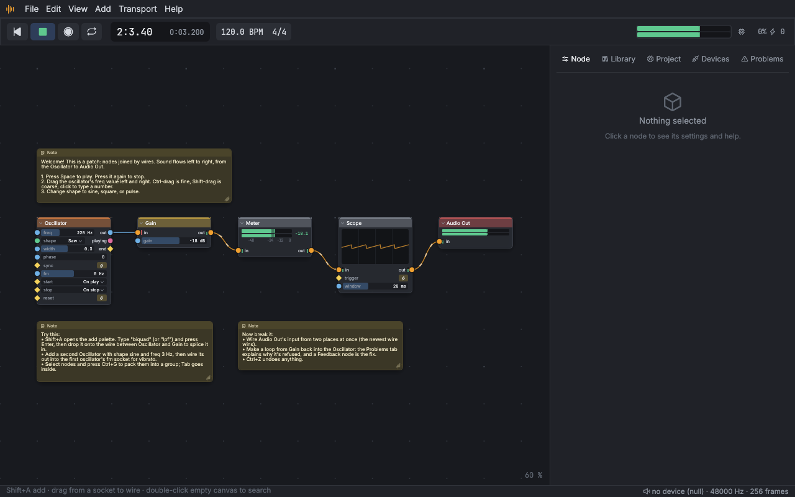

# Getting started

This chapter gets Audio Constructor onto your computer, makes a first
sound, connects your audio interface and MIDI keyboard, and saves your
work.

## Install

To try it without installing anything, it also runs in a web browser:
see [In the browser](web.md).

### Download a release

Each release on the
[releases page](https://github.com/Andorbal/audio-constructor/releases)
has an installer for your system:

- **Windows (x86-64):** `audio-constructor-v…-x86_64-pc-windows-msvc-setup.exe`.
  It installs the editor and `audioc` into Program Files, adds Audio
  Constructor to the Start menu, makes project, pack, and block files open
  in the editor, and, unless you untick them, puts the plugins in
  `Common Files\CLAP` and `Common Files\VST3`. Remove it from **Installed
  apps** like any other program.
- **macOS (Apple silicon):** `audio-constructor-v…-aarch64-apple-darwin.pkg`.
  It puts **Audio Constructor** in Applications, `audioc` in
  `/usr/local/bin` for the terminal, and, unless you untick them under
  **Customize**, the plugins in `/Library/Audio/Plug-Ins`.
- **Linux (x86-64):** `audio-constructor_…_amd64.deb` for Debian, Ubuntu,
  and their relatives: `sudo apt install ./audio-constructor_…_amd64.deb`.
  It adds the editor to your desktop's menus, `audioc` to the path, the
  examples to `/usr/share/audio-constructor`, and the plugins to
  `/usr/lib/clap` and `/usr/lib/vst3`. Remove it with
  `sudo apt remove audio-constructor`.

There's also a plain archive for each system (`.tar.gz`, or `.zip` on
Windows). Unpack it anywhere and run the programs from there:

- `audio-constructor`, the editor;
- `audioc`, the command line (see [The command line](command-line.md));
- `examples/`, the example projects. Keep this folder next to the
  programs: the editor opens the Start example from it on launch;
- `plugins/`, the CLAP and VST3 plugins (see [The plugin](plugin.md));
- on Linux, `install.sh`, which installs all of it for you alone, without
  root: the programs into `~/.local/bin`, a menu entry, and the plugins
  into `~/.clap` and `~/.vst3`. `./install.sh --uninstall` takes it away
  again.

Until a release is signed, your system may warn you the first time:

- **Windows:** when SmartScreen says it protected your PC, choose
  **More info → Run anyway**.
- **macOS:** if the installer is refused because it's from an unidentified
  developer, open **System Settings ▸ Privacy & Security** and choose
  **Open Anyway** next to its name. For the archive, clear the quarantine
  flag once, in a terminal:
  `xattr -dr com.apple.quarantine <the unpacked folder>`.

A release whose packages are signed (and, on macOS, notarized) opens
without these warnings. Each release lists every file's SHA-256 checksum in
`SHA256SUMS.txt`.

### Build it yourself

If there's no release for your system, or you want the newest version,
build it from source. You need the Rust toolchain from
[rustup](https://rustup.rs); the first build installs the exact version the
project uses.

- **Linux** also needs `pkg-config` and the ALSA and udev development
  files, for example
  `sudo apt install pkg-config libasound2-dev libudev-dev` (Debian,
  Ubuntu) or `sudo dnf install pkgconf alsa-lib-devel systemd-devel`
  (Fedora). The editor needs a desktop session and a graphics driver with
  Vulkan or OpenGL.
- **macOS and Windows** need nothing extra.

Then, in the project folder:

```
cargo build --release
```

The two programs land in `target/release/`. You can also start the editor
straight from the source folder with `cargo run --release -p ac-app`.

Two optional audio systems need their own build; see
[JACK](#jack-linux) and [ASIO](#asio-windows) below.

## First launch

Start `audio-constructor`. It opens the **Start** example: an Oscillator
through a Gain, a Meter, and a Scope into Audio Out, with notes on the
canvas.



The window has five parts:

- **The menu bar** at the top: File, Edit, View, Add, Transport, Help.
  Every command is in a menu, with its shortcut beside it.
- **The transport bar** under it: go to start, play/stop, record, loop,
  and Play keys; the song position in bars and beats and in time; the
  tempo and time signature; and, on the right, the master meter, the audio
  load, the dropout (xrun) counter, the Canvas | Panels switch, and the
  performance-mode button.
- **The canvas** in the middle, where the nodes and wires are.
- **The side panel** on the right, with tabs: Node, Library, Project,
  Devices, Problems, and Help. `N` shows or hides it.
- **The status line** at the bottom: hints and messages on the left, and
  on the right the audio device in use (click it to open the Devices
  tab) and the number of problems, if any (click to see them).

Now make a sound:

1. Press `Space`. The transport starts, the Oscillator starts with it, and
   the meters move. Press `Space` again to stop.
2. While it plays, drag the Oscillator's `freq` value left and right. Hold
   `Ctrl` for fine steps or `Shift` for coarse ones, or click the value
   and type a number.
3. Click the `shape` value and pick sine, triangle, saw, square, or pulse.

> **Try this:** press `Shift+A`, type `lpf`, and press `Enter`. Drop the
> new Biquad filter onto the wire between the Oscillator and the Gain to
> splice it in, then drag its `cutoff` down.

The Start example opens as a new, untitled copy, so saving it never
overwrites the original. If the editor can't find the examples folder, it
opens a plain Oscillator into Audio Out instead.

## Sound devices

When the editor starts, it opens your system's default audio output and
input at a buffer of 256 frames. Pick a different interface in the
**Devices** tab: press `N` if the side panel is hidden, then click
**Devices** (or click the device name in the status line).

### The Devices tab

**Running** shows what is open now: the audio system ("host"), the output
and input devices, the sample rate, the buffer size in frames and
milliseconds, the channel count, the audio load, and the xrun count
(dropouts). A warning appears here if the device was disconnected, if it
reports its own underruns or overruns, or if the system refused the audio
thread real-time priority.

**Device** chooses what to open. Pick a value in each list, then click
**Apply**:

- **Host**: the audio system. Windows offers WASAPI (and ASIO in an ASIO
  build), macOS CoreAudio, and Linux ALSA (and JACK in a JACK build).
- **Output** and **Input**: the devices. Input can be **none** if you
  only need sound out.
- **Sample rate**: **device default**, or 44 100 to 192 000 Hz where the
  device supports it.
- **Buffer**: **default**, or 32 to 2048 frames.
- **Engine threads**: how many processor cores the patch may use (see
  [High CPU](troubleshooting.md#high-cpu)). One is right for most patches.

**Refresh** reads the device list again, for an interface you plugged in
after opening the tab. Switching to a device at the same sample rate keeps
playing where it was; a different sample rate restarts the transport and
the nodes.

The editor doesn't remember the device between sessions: it starts on the
system default each time, and the Devices tab is where you pick yours
again.

If no device can be opened, the editor keeps running on a silent stand-in
("no device (null)" in the status line) and the Devices tab says why, so
you can still edit, render, and export.

### Buffer size and latency

The buffer is how much audio the computer prepares at a time. A smaller
buffer means less delay between playing a note and hearing it, but less
time to compute each buffer, so a heavy patch may crackle. The Devices
tab shows the buffer in milliseconds: 128 frames at 48 000 Hz is 2.7 ms
each way.

- For playing an instrument live through a patch, start at 128 frames and
  go down until it crackles, then back up one step.
- For listening to a patch you aren't playing, 256 or 512 is fine.

To measure the real delay through your interface, connect an output to an
input with a cable, turn your speakers down, and click **Measure
latency**. It plays a short noise burst and listens for it; the result is
the full round trip in milliseconds. The button needs a device with an
input. [Latency](live-and-baked.md#latency) explains what else adds
delay.

### MIDI

Every MIDI input is opened automatically, and new ones are found within a
couple of seconds of plugging them in. **MIDI inputs** in the Devices tab
lists what is connected; **Rescan** looks again. A MIDI In node hears all
of them (its `channel` input can narrow it to one MIDI channel).

**MIDI outputs** chooses where MIDI Out nodes send: **nowhere** (the
default), one port, or **all ports**.

The Devices tab also has sections for **Gamepads**, **OSC**, the
**Computer keys**, and **Transport buttons**. They are covered in
[Performing](performing.md).

### PipeWire (Linux)

Most Linux desktops now run PipeWire, and Audio Constructor works with it
two ways:

- **The released downloads and a plain build** use ALSA. With PipeWire's
  ALSA plugin installed (the `pipewire-alsa` package on most
  distributions, usually there already), the **default** output and input
  in the Devices tab go through PipeWire, shared with every other program.
  PipeWire adds its own buffer (its *quantum*, often 1024 frames) on top
  of the one you pick, so this is the easy way, not the lowest-latency one.
- **For low latency**, use a [JACK build](#jack-linux) and run it on
  PipeWire's JACK library: on Debian and Ubuntu install `pipewire-jack`
  and start the program with `pw-jack`, for instance
  `pw-jack audio-constructor` or `pw-jack audioc run my.acproj --host jack`;
  on Fedora and Arch the `pipewire-jack` package (or
  `pipewire-jack-audio-connection-kit`) replaces JACK's library, so no
  wrapper is needed. Pick **JACK** as the host. The buffer size is then
  PipeWire's quantum: ask for one when starting
  (`PIPEWIRE_QUANTUM=128/48000 pw-jack audio-constructor`) or set it for
  the whole system with `pw-metadata -n settings 0 clock.force-quantum 128`
  (and `clock.force-rate 48000` for the rate).

If the Devices tab says the device is busy, PipeWire holds the sound card
and its ALSA plugin isn't installed: install it, or choose the device
named **pipewire** in the Output list.

### JACK (Linux)

PipeWire works through its ALSA and JACK layers (see
[PipeWire](#pipewire-linux) above). To build with JACK, install the JACK development files
(`sudo apt install libjack-jackd2-dev`, or
`jack-audio-connection-kit-devel` on Fedora) and build with:

```
cargo build --release --features ac-app/jack,ac-cli/jack
```

Then pick **JACK** as the host in the Devices tab (or
`audioc run --host jack`). The JACK server sets the sample rate and buffer
size, so set those in your JACK tools.

### ASIO (Windows)

WASAPI works without any extra setup and is what the released downloads
use. For an interface whose ASIO driver gives lower latency, build with
ASIO support: install LLVM (the build needs `libclang`), then run

```
cargo build --release --features ac-app/asio,ac-cli/asio
```

The build downloads the ASIO SDK, or uses an unpacked copy that the
`CPAL_ASIO_DIR` environment variable points to. Pick **ASIO** as the host
in the Devices tab (or `audioc run --host asio`). The ASIO license doesn't
allow passing such a build on to others, which is why the downloads leave
it out.

## Saving and opening

- **File ▸ Save** (`Ctrl+S`) saves the project as an `.acproj` file. The
  first save asks where; **Save As** (`Ctrl+Shift+S`) saves a copy under a
  new name.
- Saving copies every audio file the project uses from outside its folder
  into an `assets/` folder next to the project file, so the folder holds
  everything the project needs.
- **File ▸ Open** (`Ctrl+O`) opens a project. It also opens a pack
  (`.acpack`: a shared project, unpacked into a new folder next to it) and
  imports a block file (`.acblock`) into your library; see
  [Blocks and sharing](blocks.md).
- **File ▸ Open Recent** lists the last ten projects. Missing ones are
  marked; you can remove them from the list.
- **File ▸ New** (`Ctrl+N`) starts a new project with an Oscillator wired
  to Audio Out.
- **File ▸ Export WAV** (`Ctrl+E`) renders the project to a 24-bit WAV
  file, the same way `audioc render` does (see
  [Recording and rendering](recording-and-rendering.md)).

If there are unsaved changes, New, Open, opening an example, and quitting
first ask whether to save them: **Save**, **Don't Save**, or **Cancel**.

The editor remembers your theme, UI scale, and recent projects (in your
user settings folder, never in projects). Projects are plain text, so they
work well with backups and version control.

### Opening the examples

The other example projects are in the `examples/` folder:

- **File ▸ Examples**, and pick one. It opens as a new, untitled copy,
  like the Start project, so saving asks where to put it and the original
  stays as it was.
- File ▸ Open, and pick one from `examples/`. This opens the file itself,
  so use **Save As** before changing it if you want to keep the original.
- From a terminal: `audio-constructor examples/guitar-pedalboard.acproj`.
- From a node's Help page (`F1`): under **Used in**, click an example to
  open it as a new, untitled copy, like the Start project.

The [Examples tour](examples.md) says what each one teaches.

## Updates

The first time you start the editor, a small box in the corner asks
whether to check for new versions. Nothing is checked until you answer:

- **Check Daily**: once a day, when it starts, the editor asks the
  project's release page whether a newer version is out. It sends nothing
  but that request: nothing about you, your computer, or your projects.
  When there is one, the same corner says so: **Download** opens its page
  in your browser, **What's New** lists the changes, **Skip This Version**
  stops it mentioning that one, and **Later** asks again tomorrow.
- **Don't Check**: it never asks the internet anything by itself.

Change your mind under **Help ▸ Check for Updates Daily**. **Help ▸ Check
for Updates…** asks right away, whatever you chose, and says if you're up
to date. Nothing is downloaded or installed for you; installing a new
version is the same as installing the first one. From a terminal,
`audioc version --check` asks the same question.

Next: [The editor](editor.md).
