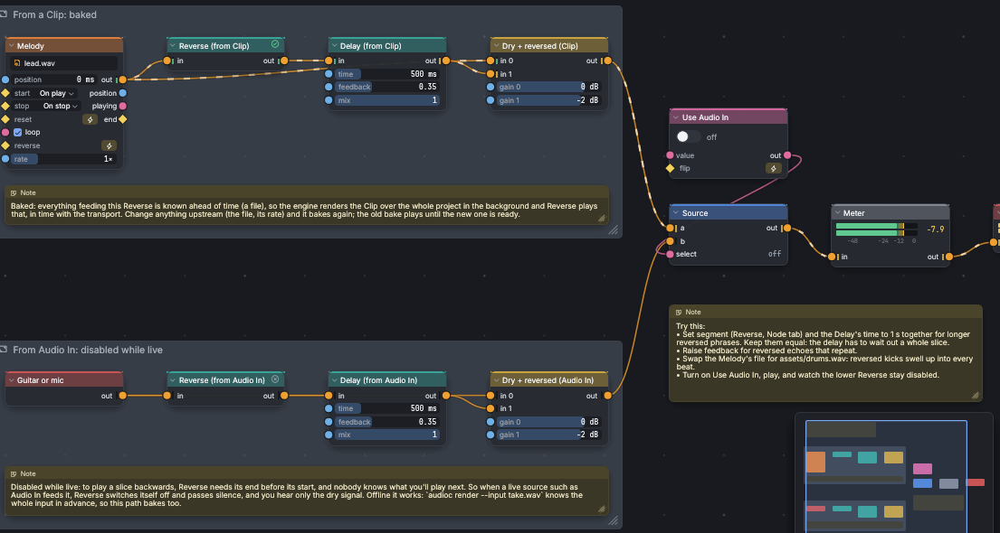

# Live and baked

Almost every node works on sound as it arrives: a filter only needs the
sample in front of it and a few before. A few nodes need to hear their
**whole input** before they can play anything. Reverse is the clearest
case: to play a phrase backwards it has to start with the phrase's end.

Audio Constructor doesn't make you switch between a "live" mode and an
"offline" mode for these. Each such node looks at what feeds it and does
the right thing on its own. This chapter explains what it decides, what
the badges mean, and how latency fits in.

## Live sources

A **live source** is anything whose future nobody knows:

- **Audio In** (a microphone, a guitar, a line input);
- **MIDI In**;
- **Gamepad**, **Keyboard In**, and **OSC In**;
- **Info**, whose load and dropout readings depend on the machine.

Everything else is known ahead of time: a Clip plays a file, an
Oscillator, Noise (with its seed), a Pattern, a MIDI Pattern, and the
Transport compute the same thing every time. Knobs, sliders, buttons, and
other controls count as known too: the patch uses their current setting,
and moving one counts as a change to the patch (see below).

## Nodes that need their whole input

Two nodes need their whole input: **Reverse** (plays its input
backwards) and **Normalize** (turns a whole signal up or down so its peak
or loudness hits a target). In the node reference they are marked
"whole input (baked)".

### Baked

When everything feeding such a node is known ahead of time, the engine
**bakes** it: in the background, it renders the part of the patch that
feeds the node from the start of the song to the project's **Length**
(Project tab), gives that to the node, and the node then plays its result
in time with the transport.

- While the bake runs, the node shows the **baking** badge (a clock) and
  plays silence, or its previous bake if it had one.
- When it's done, the badge turns to **baked** (a green check).
- Change anything upstream (a different file, a moved knob, a new wire)
  and it bakes again. The old bake keeps playing until the new one is
  ready, so the music doesn't stop.

A bake covers the project's Length and no more: past the end, or while
the transport is stopped, a baked node is silent. If your song is longer
than the Length in the Project tab, raise it.

### Disabled while live

When a live source feeds a whole-input node, there is nothing to bake:
nobody knows what you'll play next. The node is **disabled**: it shows a
grey crossed circle, plays silence, and the Problems tab lists it
("needs a known input; disabled while live", naming the live source).
The rest of the patch plays normally.

Nothing is broken, and nothing needs fixing. When you render the project
offline, the node works (below). To hear it in the editor, feed it from
something known instead: record what you play with a Record node, then
play the take back through a Clip.

> **Try this:** open the **Reverse Delay** example. The same reverse echo
> is built twice: the copy fed by a Clip is baked, and the copy fed by
> Audio In is disabled. Switch on **Use Audio In** and play to hear the
> difference.



### Offline, everything works

An offline render (`audioc render`, or File ▸ Export WAV) knows the whole
input in advance, so every whole-input node bakes. Audio In nodes play
silence in an offline render, unless you give `audioc render` a recording
to use as the input with `--input take.wav`; then a Reverse fed by Audio
In works too. See [Recording and rendering](recording-and-rendering.md).

To see which nodes are baked or disabled without opening the editor:

```
audioc validate examples/reverse-delay.acproj
```

lists the disabled nodes, what feeds them, and how many whole-input nodes
bake when played. The Project tab's **Engine** section shows the same
counts ("1 baked · 0 baking · 1 disabled").

## Latency

Latency is the delay between something happening and you hearing it.
There are three kinds.

### The sound card

Your audio interface works in buffers, and each one takes time to fill
and to play. The Devices tab shows the buffer length in milliseconds; the
round trip from input to output is at least two buffers, plus whatever
the interface and its driver add. **Measure latency** in the Devices tab
(or `audioc latency`) measures the real round trip with a cable from an
output to an input. A smaller buffer means less latency; see
[Buffer size and latency](getting-started.md#buffer-size-and-latency).

### Notes and controls

MIDI notes, key presses, gamepad buttons, and OSC messages arrive one
buffer late on purpose: each lands at the same point in the next buffer as
it arrived in the last one, so the timing between notes stays exact
instead of jittering to buffer boundaries. Smaller buffers shorten this
too. MIDI Out and OSC Out send one buffer after the patch makes the
message.

### Nodes that delay

Some nodes delay what passes through them to do their job: an **FFT**
(its frame size, 2048 samples by default), **Pitch Shift**, **Pitch
Detect**, **Onset**, a **Lookahead**, a **Shaper** (a few samples, for its
oversampling), a **Band Split** in its FFT mode, and the **Latency** node,
which exists to add a set delay. These nodes show a timer badge; hover it
for the delay in samples and milliseconds.

Wherever a delayed path meets one that isn't delayed, at a Mix, for
example, the engine delays the faster path by the same amount, so they
stay in time. This is **latency compensation**, and it happens on its
own: a dry signal mixed with an FFT-processed copy lines up exactly. It
delays audio, notes, and triggers; values that change only once per
buffer (a knob, an LFO) aren't delayed.

The total delay the patch adds on the way to the outputs is shown in the
Project tab as **Output latency**, and printed by `audioc validate`, which
also lists each node that adds some. When you play an instrument live
through a patch, this adds to the sound card's latency, so keep large
FFTs and pitch shifters out of the live path, or give the FFT a smaller **Size**.

A **Feedback** node delays its loop by one buffer. That's what makes a
loop possible, and it means a loop's timing depends on the buffer size.

Next: [Blocks and sharing](blocks.md).
